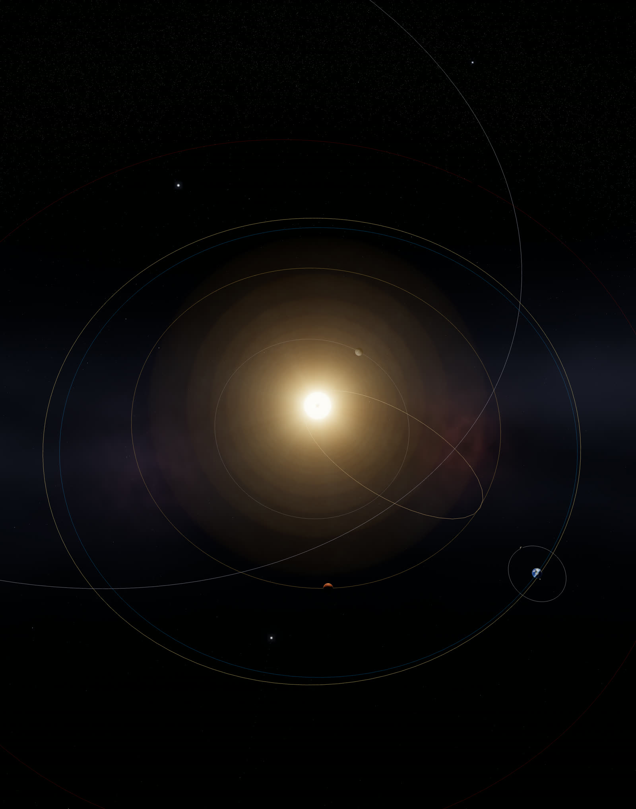
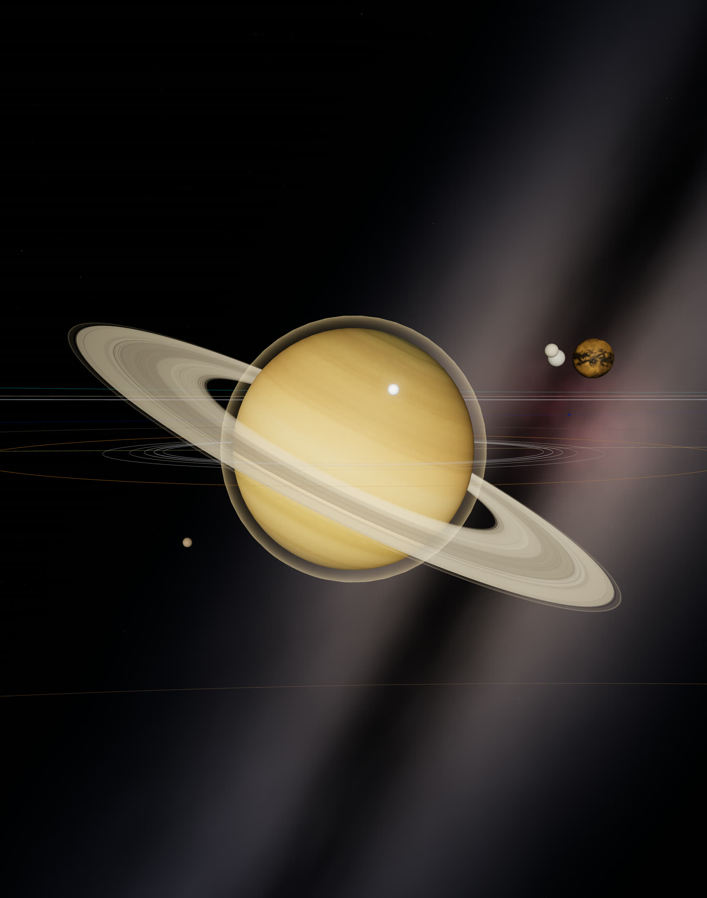
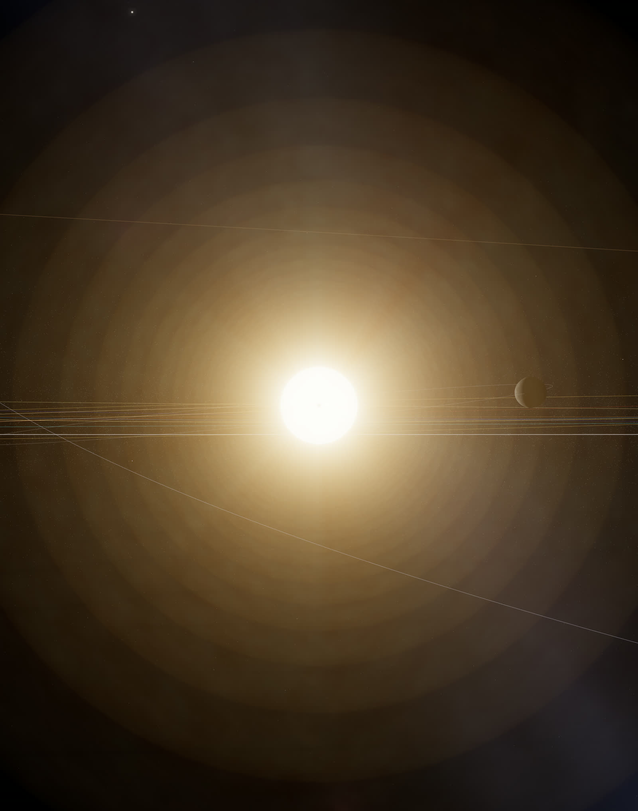
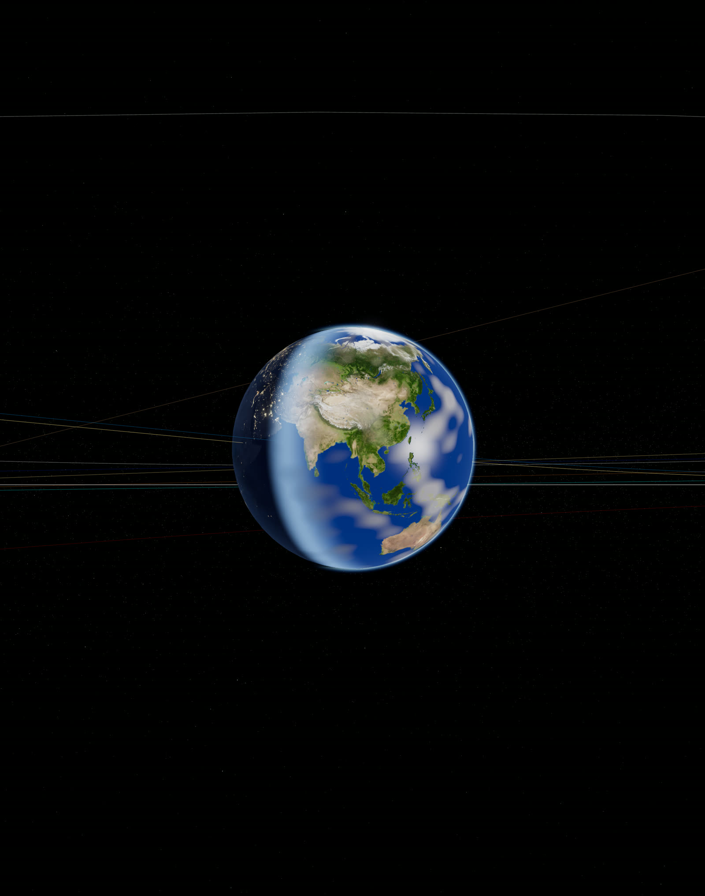
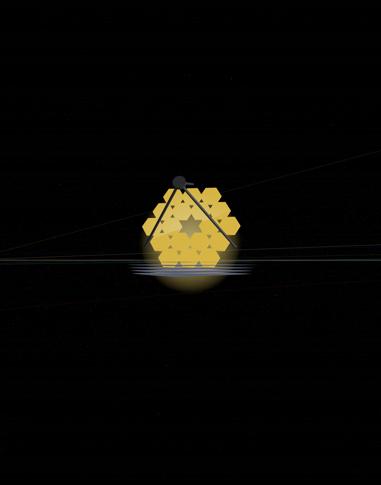

# Solar System Simulator

A real-time, interactive 3D solar system simulator built with Three.js and TypeScript. Features N-body gravitational physics, a procedurally animated Sun, physically-based atmospheres, real spacecraft flying their actual JPL trajectories, and a real-time mode driven by cached NASA/JPL Horizons state vectors.

<p align="center">
  
</p>

<p align="center">
  
  
  
</p>
<p align="center">
  
</p>

## Features

- **N-Body Physics** -- Full gravitational simulation with RK4 (Runge-Kutta 4th order) and Velocity Verlet integrators, plus an optional 1PN relativistic correction that reproduces Mercury's real 43"/century perihelion precession.
- **28 Bodies** -- Sun, 8 planets, Pluto, Halley's Comet, Earth's Moon, 4 Galilean moons, 7 Saturn moons, and 5 real spacecraft (Voyager 1 & 2, New Horizons, Parker Solar Probe, JWST) flying their actual JPL Horizons trajectories.
- **Procedural Sun** -- Animated 3D-noise photosphere with granulation, faculae, physically correct limb darkening, and a drifting corona.
- **Physically-Based Atmospheres** -- Rayleigh/Mie scattering on Earth, Venus, Mars, and Titan; real-time Earth clouds with cast shadows, ocean specular glint, and city lights on the dark side.
- **60,000 Real Asteroids** -- GPU-propagated from actual JPL Small-Body Database orbital elements -- the Kirkwood gaps and Jupiter's Trojan clouds emerge naturally.
- **Lit Saturn Rings** -- Sun-shaded rings with an analytic planet shadow and backlit forward scattering.
- **Horizons Real-Time Mode** -- Positions planets, moons, and spacecraft from a browser-loaded NASA/JPL Horizons vector cache (2020-2035), with cubic Hermite interpolation. Boots directly into the current real-world date.
- **Ephemeris Cache Tooling** -- `npm run generate-ephemeris` regenerates the Horizons vector cache from the public JPL API.
- **Realistic Rotation** -- All bodies rotate at their real sidereal periods with correct axial tilts.
- **Mission Planner** -- Porkchop-plot delta-v planner using a universal-variable Lambert solver; launch a probe on a real, N-body-integrated transfer trajectory.
- **Eclipse & Event Finder** -- Scans the ephemeris for upcoming solar/lunar eclipses, conjunctions, and oppositions, then flies the camera to watch them happen.
- **Orbit Visualization** -- Predicted orbital paths drawn as rings, with moon orbits attached to parent planets.
- **Interactive UI** -- Tweakpane-based control panel with tabs for simulation, camera, body selection, visuals, and info, plus a cinematic camera director and guided tour mode.
- **God Mode** -- Click to spawn new bodies, including exact Lagrange-point Trojan drops.
- **Body Selection** -- Click any planet or spacecraft to select it and view its data card.
- **Log / Real Scale Views** -- Toggle between educational, logarithmic, and true-physical-scale views.
- **Live Event Scan & Conservation HUD** -- Closest-pair/conjunction tracking plus energy, angular-momentum, and barycenter drift readouts.
- **Collision Detection** -- Bodies merge on collision, conserving momentum.
- **Save / Load** -- Export or import the full simulation state, with autosave.

## Getting Started

### Prerequisites

- Node.js 18+
- npm

### Installation

```bash
# Clone the repository
git clone https://github.com/SomaliSkinnyAI/SolarSystemSimulator.git
cd SolarSystemSimulator

# Install dependencies
npm install

# Download planet textures (NASA/USGS/Solar System Scope -- public domain)
npm run download-textures

# Optional: refresh the 2024-2028 NASA/JPL Horizons vector cache
npm run generate-ephemeris

# Start the dev server
npm run dev
```

Open `http://localhost:5173` in your browser.

### Build for Production

```bash
npm run build
npm run preview
```

## Controls

| Input | Action |
|-------|--------|
| Left-click drag | Rotate camera |
| Scroll wheel | Zoom in/out |
| Right-click drag | Pan camera |
| Click planet label | Select body, show data card |
| Double-click label | Lock camera to body |
| G | Toggle God Mode |
| God Mode click | Spawn new body |
| God Mode drag | Set spawn velocity |

## UI Panel

- **Sim** -- Pause/resume, time scale (1x to 1,000,000x), gravity mode, integrator selection, reset, real-time toggle, God Mode
- **Camera** -- Focus mode, reset camera
- **Body** -- Select body from dropdown, delete bodies
- **Visual** -- Trails, bloom, asteroid belt, solar wind, Lagrange points, gravity field, atmospheres, log scale
- **Info** -- FPS, body count, simulation time, simulation date (in real-time mode)

## Architecture

```
src/
  main.ts                  # Animation loop, event wiring
  types.ts                 # Shared TypeScript interfaces
  data/
    solarSystemData.ts     # Initial body states (positions, velocities, masses)
    realTimeOrbits.ts      # JPL Keplerian fallback elements, Kepler equation solver
    horizonsEphemeris.ts   # Cached Horizons vector interpolation
  physics/
    CelestialBody.ts       # Body class (mesh + physics state + rotation)
    PhysicsEngine.ts       # N-body integrator (RK4/Euler), collision detection
  rendering/
    SceneManager.ts        # Three.js scene, camera, postprocessing, orbit rings, labels
    TrailRenderer.ts       # GPU-efficient trail lines
    StarField.ts           # Background star particles
  ui/
    BodySelector.ts        # Raycasting, selection ring, God Mode spawning
    UIManager.ts           # Tweakpane control panel
  utils/
    CoordinateSystem.ts    # Physics-to-scene coordinate mapping, log scale
    EventPredictor.ts      # Live orbital event diagnostics
    TransferPlanner.ts     # Hohmann transfer estimates
    MathUtils.ts           # Gravitational constants, formatting
```

## Tech Stack

- **Three.js** r167 -- 3D rendering, post-processing (UnrealBloomPass), CSS2DRenderer for labels
- **TypeScript** -- Strict mode with `noUncheckedIndexedAccess`
- **Vite** -- Dev server and bundler
- **Tweakpane** v4 -- UI controls

## Texture Sources

Planet textures are downloaded via `npm run download-textures` from:

- [Solar System Scope](https://www.solarsystemscope.com/textures/) -- Sun, Mercury, Venus, Earth, Moon, Mars, Jupiter, Saturn, Uranus, Neptune (CC BY 4.0)
- [Planet Pixel Emporium](https://planetpixelemporium.com/) -- Pluto
- [USGS Astrogeology](https://astrogeology.usgs.gov/) -- Io, Ganymede, Callisto, Titan (public domain)
- [Steve Albers](https://stevealbers.net/albers/sos/sos.html) -- Europa 4K (Voyager/Galileo/Juno composite)

## License

MIT
